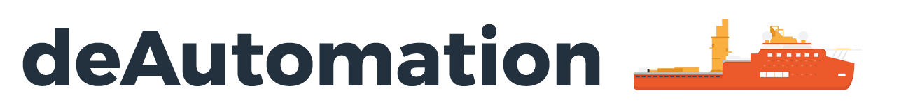

  <picture>
    <source media="(prefers-color-scheme: dark)" srcset="https://raw.githubusercontent.com/deAutomation/.github/main/profile/assets/logo-v2-dark.png">
    <source media="(prefers-color-scheme: light)" srcset="https://raw.githubusercontent.com/deAutomation/.github/main/profile/assets/logo-v2-light.png">
    
  </picture>

  <strong>Operational Data Analysis &bull; Enterprise Integrations &bull; Labour Automation</strong> 
  Turning weeks of manual reporting and spreadsheet grunt work into automated minutes.

  <a href="https://deautomation.co">Website</a> &bull;
  <a href="https://data.deautomation.co">Alternative Data</a> &bull;
  <a href="https://claimcheck.deautomation.co">ClaimCheck</a> &bull;
  <a href="mailto:hi@deautomation.co">hi@deautomation.co</a> &bull;
  Adelaide, South Australia

---

### System Integrations &amp; Backend Experience

<table>
  <tr>
    <td width="50%" valign="top">
      <h4>🏗️ Jobpac Backend Integration</h4>
      
Direct ERP backend pipelines extracting WIP, commitments, general ledger, and job costing. Reconciles transaction records into live Power BI models with zero manual export handling.

    </td>
    <td width="50%" valign="top">
      <h4>📑 Aconex Backend Integration</h4>
      
Enterprise Oracle Aconex API integrations for automated document register synchronization, defect tracking workflows, and cross-platform quality reporting.

    </td>
  </tr>
  <tr>
    <td width="50%" valign="top">
      <h4>🛡️ Safety System Backends</h4>
      
Direct API integration with enterprise HSE platforms (including HammerTech)&mdash;delivering automated compliance scoring, subcontractor risk tracking, and real-time safety KPI boards.

    </td>
    <td width="50%" valign="top">
      <h4>🛏️ Accommodation System Experience</h4>
      
Custom API-connected operations and barcode scanning workflows managing turnover, occupancy, and asset logistics across 3,300+ room workforce accommodation facilities.

    </td>
  </tr>
  <tr>
    <td width="50%" valign="top">
      <h4>📊 Custom Visualisation Boards</h4>
      
Bespoke executive, operational, and site performance dashboards built for multiple commercial and public sector clients&mdash;unifying fragmented data into decision-ready views.

    </td>
    <td width="50%" valign="top">
      <h4>🛰️ Alternative Data &amp; Forensics</h4>
      
Proprietary industry datasets at <a href="https://data.deautomation.co">data.deautomation.co</a> and automated progress claim discrepancy auditing at <a href="https://claimcheck.deautomation.co">claimcheck.deautomation.co</a>.

    </td>
  </tr>
</table>

---

### Proven Commercial Impact &amp; Labour Savings

> *"1.5 weeks of labour into 10 minutes."* &mdash; **General Manager, Commercial Construction**  
> *"No one has ever done this with our API before."* &mdash; **Product Lead, Enterprise Safety SaaS Provider**

* **1.5 weeks &rarr; 10 minutes:** Monthly reporting cycle time cut by automating cross-system data extraction and reconciliation.
* **\$400K+ annual recurring savings (\$2M over 5 years):** Delivered through automated real-time tracking across 3,300+ remote rooms.
* **\$1M+ in profit discrepancies identified:** Surfaced via forensic transaction audits across \$200M+ in commercial project contracts.
* **\$5.5M in avoided costs:** Achieved with custom operational insight and predictive utilization tools.

---

### Principal Profile

<table>
  <tr>
    <td width="90" align="center" valign="middle">
      
    </td>
    <td valign="middle">
      <strong>Benjamin Duivesteyn</strong> &mdash; Principal &amp; Sole Director 
      <em>Operational data engineering, enterprise integrations, and labour automation.</em> 
      Adelaide, South Australia &bull; <a href="https://deautomation.co">deautomation.co</a> &bull; <a href="mailto:hi@deautomation.co">hi@deautomation.co</a>
    </td>
  </tr>
</table>

  deAutomation Pty Ltd &bull; ACN 703 041 310

